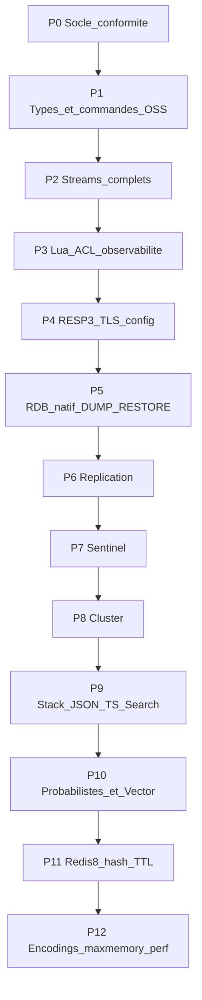

# Plan d’implémentation — parité Redis complète (Ferredis)

## Objectif et baseline

- **Cible :** Redis Open Source **8.0** (inclut le cœur 7.2, Redis Stack JSON/Search/TimeSeries, structures probabilistes, Vector set, hash field TTL).
- **Baseline actuelle :** ~188 commandes dans [`ferredis-core/src/command.rs`](ferredis-core/src/command.rs) (`SUPPORTED_COMMANDS`), `REDIS_COMPAT_VERSION = "7.2.0"` dans [`cmd_server.rs`](ferredis-core/src/cmd_server.rs), RESP2 only, RDB propriétaire `FRDB001` ([`persist.rs`](ferredis-core/src/persist.rs)), pas de réplication / Sentinel / Cluster / TLS réel.
- **Règle de vérité :** comportement Redis/Memurai ; chaque écart = bug Ferredis. Aucun contournement Galaxy.
- **Zéro impasse :** aucune fonctionnalité de l’audit ne peut être reportée « plus tard / nice-to-have / Windows only / Linux only / stub OK en prod ». Un stub n’est accepté que le temps d’une phase non encore atteinte, listé dans la matrice CI, et doit disparaître à la phase prévue. Pas de « approximation suffisante » pour HLL, geo, RDB, ACL, RESP3, HA, Stack, etc.
- **Critère de fin de phase :** suite de tests dédiée + smoke `redis-py`/`redis-cli` + `COMMAND LIST` / diff contre Redis de référence ; **tests verts sur Windows et Linux** ; `INFO redis_version` avancé à la version cible de la phase.

---

## Principes d’ingénierie transverses (obligatoires sur P0–P12)

Ces règles s’appliquent à **tout** nouveau code et aux refactors des modules existants (`command.rs`, `cmd_*.rs`, `store.rs`, `blocking.rs`, `script.rs`, persistence, Stack). Elles ne sont pas optionnelles.

### DRY — éliminer la réplication de code

- **Une seule table de dispatch** (build script / macro) : arity, flags, key-specs, handler, catégories ACL ; plus de `match` géant dupliqué avec `SUPPORTED_COMMANDS`.
- Factoriser les familles : parseurs d’options communs (`NX/XX/GT/LT/CH`, `LIMIT offset count`, `WITHSCORES`, timeouts bloquants, SCAN MATCH/COUNT/TYPE), helpers RESP2/3, chemins « store or create typed value », zset range (score/lex/rank), set operations (inter/union/diff → store ou pas).
- Bloquants (`BLPOP`, `BZPOPMIN`, `BLMPOP`, `BZMPOP`, `XREAD BLOCK`, …) : **un seul** moteur d’attente (`Notify` + registration avant tentative), paramétré par stratégie de pop — pas une copie par commande.
- Persistence : un codec RDB partagé pour SAVE/BGSAVE/DUMP/RESTORE/MIGRATE/réplication full sync.
- Interdit : copier-coller de commandes « presque pareilles » (ex. ZRANGEBYSCORE vs ZREVRANGEBYSCORE) sans paramètre `rev` / iterator générique.

### SOLID — modularité et responsabilités

- **S** : un module = une famille (bitmap, stream, acl, rdb, repl, …) ; `command.rs` ne fait que l’admission + dispatch.
- **O** : ajouter une commande = enregistrer un handler dans la table, sans modifier le cœur du serveur.
- **L/I** : traits stables pour store typé (`KeySpace`, `BlockingPop`, `ReplSink`, `RespWriter`) afin que Stack/probabilistes/vector branchent le même pipeline.
- **D** : le serveur TCP dépend d’abstractions (store, conf, ACL, persistence), pas l’inverse ; faciliter tests unitaires sans socket.

### Performance — exploiter le multithreading Rust

- **Tokio** multi-thread runtime pour les connexions ; ne jamais bloquer le worker sur CPU long (Lua, SEARCH, BITOP larges, SAVE) : `spawn_blocking` / pool dédié avec budgets.
- **`io-threads`** (P4/P12) : parse RESP + write buffers sur threads dédiés, chemin chaud sans contention inutile.
- Sharding du keyspace (par slot cluster ou hash de clé) + `parking_lot` / structures lock-free là où Redis autorise le parallélisme lecteur ; `exec_lock` écriture seulement pour EXEC/EVAL/atomicité requise.
- Pipelining : batch flush déjà en place à préserver ; éviter allocations sur hot path (`Bytes`, buffers réutilisés).
- BGSAVE / AOF rewrite / UNLINK async / eviction : tâches de fond concurrentes, sans geler les clients.
- Objectif mesurable : benches `redis-benchmark` (GET/SET/LPUSH/ZADD/PUBLISH) et workloads Channels sur **Windows et Linux**, comparés à Redis 8 ; régressions = échec de phase.
- Utiliser les forces Rust : ownership pour éviter les data races, `Send`/`Sync` explicites, pas de GIL ; rayon/parallel **uniquement** sur ops CPU bulk (ex. BITOP multi-clés, FT.AGGREGATE) quand le gain est prouvé.

### Compatibilité native Linux / Windows — vérifiée, pas « best effort »

- Ferredis est un serveur **natif** sur les deux OS (pas WSL obligatoire, pas Docker obligatoire pour tourner).
- Toute feature OS-sensible (fork absent sous Windows pour BGSAVE, Unix sockets, TLS schannel vs openssl/rustls, chemins de fichiers, signaux SHUTDOWN) a une **implémentation correcte sur chaque OS** : sous Windows, snapshot sans `fork` (copy cohérente / process dédié) **équivalent fonctionnel** Redis/Memurai ; sous Linux, privilégier COW/fork quand c’est le modèle Redis.
- Unix sockets : supportés sur Linux ; sur Windows, named pipes ou équivalent documenté **et testé**, ou surface Redis `unixsocket` claire — pas de feature silencieusement ignorée.
- **CI obligatoire** sur GitHub Actions : `windows-latest` **et** `ubuntu-latest` pour `cargo test --workspace`, smokes `integration/`, et jobs cluster/réplication multi-process dès P6+.
- Interdit de merger une phase si un seul des deux OS est vert.
- Packaging final (P12) : artefact Windows + artefact Linux pour server/cli/gui.

### Qualité « aucune impasse »

- Revue de phase : checklist audit 100 % cochée pour le périmètre de la phase.
- Pas de `todo!`, `unimplemented!`, `OK` no-op, ni commentaires « ignore for now » laissés après la phase propriétaire (ex. `XREAD BLOCK` ignoré = interdit après P2).
- Parité de **sémantique** (erreurs exactes, options, edge cases) avant optimisation micro ; ensuite perf sans casser les tests de compat.

**Décisions figées (pas d’alternatives) :**
1. Implémenter un **RDB Redis-compatible** (opcodes Redis) ; migrer hors de `FRDB001` (lecteur de transition une version).
2. **RESP3** avant client tracking / HELLO 3.
3. Ordre HA : **réplication → Sentinel → Cluster**.
4. Modules Stack **embarqués** (comme Redis 8), pas de `MODULE LOAD` de `.so` tiers en V1 ; `MODULE LIST` exposera les modules internes.
5. Encodings Redis réels (listpack/intset/…) en **P12** ; jusque-là les commandes sont sémantiquement correctes avec structures Rust actuelles, `OBJECT ENCODING` documenté comme simplifié jusqu’à P12 — **sans** indiquer une fausse parité encoding dans INFO.
6. Architecture **SOLID/DRY** et perf multithread (section ci-dessus) dès P0 : refactor du dispatch avant d’empiler des dizaines de commandes P1.
7. **CI bi-OS** (Windows + Linux) gate chaque phase ; pas d’impasse fonctionnelle ni plateforme.
8. **Exécution strictement séquentielle** (une phase à la fois). Interdit de paralléliser des phases qui touchent les mêmes pivots (`command_registry`, `value.rs`, `rdb/*`, `server.rs`, `persist.rs`) — les forks P4∥P5 et P6∥P9 ont provoqué des conflits de fichiers et des compiles cassées. Stack (P9+) après HA (P6–P8) pour stabiliser réplication/RDB avant d’étendre les types.

---

## P0 — Socle de conformité (fondations pour tout le reste)

**Fichiers pivots :** [`command.rs`](ferredis-core/src/command.rs), [`cmd_server.rs`](ferredis-core/src/cmd_server.rs), [`resp.rs`](ferredis-core/src/resp.rs), [`server.rs`](ferredis-core/src/server.rs), [`store.rs`](ferredis-core/src/store.rs), nouveau `ferredis-core/src/stats.rs`.

- Matrice de couverture : générer depuis Redis 8 `COMMAND LIST` un inventaire machine ; CI échoue si une commande cible manque ou si un stub reste marqué `todo`.
- `COMMAND` complet : `COUNT`, `LIST`, `INFO`, `DOCS`, `GETKEYS`, `GETKEYSANDFLAGS` (tables arity/flags/key-specs Redis).
- Stats runtime : `keyspace_hits` / `misses`, `total_commands_processed` par commande, `errorstats`, `instantaneous_ops`, CPU ; brancher `INFO` et futurs `COMMANDSTATS`.
- `SLOWLOG` réel (seuil config, ring buffer) : `GET` / `LEN` / `RESET`.
- `LATENCY` : `LATEST`, `HISTORY`, `RESET`, `DOCTOR`, `GRAPH`, `HISTOGRAM` (échantillonnage commandes lentes + events fork/aof).
- `MONITOR` (fan-out des commandes aux clients monitor).
- `SHUTDOWN` `[NOSAVE|SAVE]` `[NOW]` `[FORCE]` `[ABORT]` + hooks persistence.
- `LOLWUT` `[VERSION]`.
- `FLUSHDB` / `FLUSHALL` options `ASYNC` | `SYNC`.
- `UNLINK` réellement asynchrone (queue de libération hors chemin critique).
- `LASTSAVE` = timestamp du dernier SAVE/BGSAVE réussi.
- `WAIT` branché dès qu’un backlog réplica existe (renvoie 0 tant que P6 pas prêt, mais API stable).
- `CONFIG GET/SET` : surface complète des clés Redis pertinentes (au minimum : `save`, `dir`, `dbfilename`, `appendonly`, `appendfsync`, `appendfilename`, `requirepass`, `masterauth`, `maxmemory`, `maxmemory-policy`, `maxclients`, `timeout`, `tcp-keepalive`, `notify-keyspace-events`, `slowlog-*`, `latency-monitor-threshold`, `hz`, `databases`, `replica-*`/`slave-*`, `cluster-*`, `tls-*`, `protected-mode`, `bind`, `port`, `unixsocket`, `io-threads`) ; `CONFIG RESETSTAT` ; `CONFIG REWRITE` vers fichier conf.
- Fichier conf style `ferredis.conf` / `redis-full.conf` + parsing au démarrage ([`ferredis-server/src/main.rs`](ferredis-server/src/main.rs)).
- Protected-mode Redis, `bind`, `port`, Unix socket (`unixsocket` / `unixsocketperm`).
- Tests : snapshot `COMMAND LIST` vs Redis 8 de référence (allowlist de commandes encore `not_implemented` uniquement hors phase courante).

---

## P1 — Compléter le cœur OSS manquant (hors Streams groups / HA)

### Bitmaps — nouveau module `cmd_bitmap.rs`
- Compléter `BITCOUNT` : `start end [BYTE|BIT]`.
- `BITPOS`, `BITOP` (`AND|OR|XOR|NOT`), `BITFIELD`, `BITFIELD_RO` (overflow WRAP/SAT/FAIL, GET/SET/INCRBY).

### Lists
- `LMPOP`, `BLMPOP` (LEFT/RIGHT, COUNT) dans [`cmd_list.rs`](ferredis-core/src/cmd_list.rs) + [`blocking.rs`](ferredis-core/src/blocking.rs).

### Sets / Hashes
- `SINTERCARD` ([`cmd_hashset.rs`](ferredis-core/src/cmd_hashset.rs)).
- `HRANDFIELD` `[count [WITHVALUES]]`.

### Sorted sets — [`cmd_zset.rs`](ferredis-core/src/cmd_zset.rs) + [`value.rs`](ferredis-core/src/value.rs)
- Lex : `ZRANGE BYLEX`, `ZRANGEBYLEX`, `ZREVRANGEBYLEX`, `ZREMRANGEBYLEX`, `ZLEXCOUNT` (membres iso-score, ordre lexicographique Redis).
- `ZDIFF`, `ZDIFFSTORE`, `ZINTER`, `ZINTERCARD`, `ZUNION` (WEIGHTS/AGGREGATE/WITHSCORES/LIMIT).
- `ZRANDMEMBER`, `ZRANGESTORE`, `ZMPOP`, `BZMPOP`.

### HyperLogLog — type dédié `RedisValue::HyperLogLog` (plus l’émulation set)
- Dense/sparse Redis ; `PFADD`, `PFCOUNT` conformes ; `PFMERGE` ; `PFDEBUG`, `PFSELFTEST` ; `TYPE` = `string` avec encoding HLL.

### Geo — geohash Redis 52-bit réel
- Réécrire score geo ; `GEOADD` options `NX|XX|CH`.
- `GEOHASH`, `GEORADIUS`, `GEORADIUS_RO`, `GEORADIUSBYMEMBER`, `GEORADIUSBYMEMBER_RO`, `GEOSEARCH`, `GEOSEARCHSTORE` (unités, WITHDIST/WITHCOORD/WITHHASH, COUNT ANY, ASC/DESC, STORE/STOREDIST).

### Generic keys
- `SORT`, `SORT_RO` (BY, LIMIT, GET, ASC/DESC, ALPHA, STORE).
- `LCS` (LEN, IDX, MINMATCHLEN, WITHMATCHLEN).
- `SWAPDB`.
- `DUMP` / `RESTORE` / `RESTORE-ASKING` / `MIGRATE` : **API + tests stubs jusqu’à P5** (sérialisation RDB) — déclarés et branchés dès que le codec RDB P5 est prêt ; en P1 exposer la surface et erreurs `LOADING`/`NOSCRIPT`-style uniquement si codec pas prêt… **Décision :** P1 implémente tout sauf sérialisation binaire ; `DUMP`/`RESTORE`/`MIGRATE` sont livrés **dans P5** (listés ici pour traçabilité, exécutés en P5).

### Pub/Sub sharded
- `SPUBLISH`, `SSUBSCRIBE`, `SUNSUBSCRIBE` + `PUBSUB SHARDCHANNELS` / `SHARDNUMSUB` réels ([`pubsub.rs`](ferredis-core/src/pubsub.rs)).

### Transactions
- Alignement WATCH/MULTI/EXEC/DISCARD/UNWATCH + bloquants dans MULTI sur cas Redis (suite de tests de compat dédiée).

---

## P2 — Streams complets (consumer groups)

**Fichiers :** nouveau `cmd_stream.rs`, étendre [`value.rs`](ferredis-core/src/value.rs) (`Stream`, groups, PEL, consumers).

- `XADD` : `NOMKSTREAM`, `MAXLEN`/`MINID` `~|=` `LIMIT`, IDs stricts, options Redis 7+ `KEEPREF`/`DELREF`/`ACKED` si dans surface 8.
- `XREAD` : **`BLOCK` réel** (comme BLPOP).
- `XRANGE` / `XREVRANGE` / `XLEN` / `XDEL` / `XTRIM` / `XSETID`.
- `XGROUP` : `CREATE` (MKSTREAM, ENTRIESREAD), `CREATECONSUMER`, `DELCONSUMER`, `DESTROY`, `SETID`.
- `XREADGROUP`, `XACK`, `XCLAIM`, `XAUTOCLAIM`, `XPENDING`.
- `XINFO` : `STREAM` `[FULL COUNT]`, `GROUPS`, `CONSUMERS`.
- Persistence FRDB→RDB (P5) doit inclure streams+groups ; jusqu’à P5, AOF replay des commandes.

---

## P3 — Lua complet, Functions, ACL réel, admin clients

### Lua ([`script.rs`](ferredis-core/src/script.rs))
- Modules `cjson`, `cmsgpack`, `bit` (comportement Redis 5.1).
- `redis.setresp` effectif ; `redis.log` → serveur logs ; `redis.sha1hex` déjà présent à vérifier.
- `SCRIPT KILL`, `SCRIPT DEBUG` (`YES|SYNC|NO`), `SCRIPT FLUSH` `ASYNC|SYNC`.
- `EVAL_RO` / `EVALSHA_RO` : refus des commandes d’écriture (pas des alias).

### Functions
- Nouveau `functions.rs` : `FUNCTION LOAD|DELETE|LIST|DUMP|RESTORE|FLUSH|KILL|STATS`, `FCALL`, `FCALL_RO` (engine Lua library Redis).

### ACL réel
- Fichier ACL users/rules ; `ACL SETUSER`, `GETUSER`, `DELUSER`, `USERS`, `LIST`, `CAT`, `DRYRUN`, `GENPASS`, `WHOAMI`, `LOAD`, `SAVE`, `LOG`.
- Brancher auth `AUTH` / `HELLO … AUTH` sur ACL ; catégories `@keyspace`, `@read`, `@write`, `@admin`, `@pubsub`, `@scripting`, `@connection`, `@dangerous`, + futures `@search`/`@json`/…

### CLIENT
- Effets réels : `PAUSE`/`UNPAUSE`, `UNBLOCK`, `REPLY ON|OFF|SKIP`, `NO-EVICT`, `NO-TOUCH`.
- `KILL` filtres `TYPE`, `USER`, `LADDR`, `MAXAGE`, `SKIPME`.
- Tracking : après P4 RESP3 — `CACHING`, `TRACKING`, `GETREDIR`, `TRACKINGINFO`.

### MEMORY
- `USAGE`, `STATS`, `PURGE`, `MALLOC-STATS`, `DOCTOR` (heuristiques).

---

## P4 — RESP3, TLS, I/O

**Fichiers :** [`resp.rs`](ferredis-core/src/resp.rs), [`server.rs`](ferredis-core/src/server.rs), nouveau `tls.rs`.

- Types RESP3 : null, bool, double, big number, verbatim, map, set, push, attribute.
- `HELLO 3` ; push messages (pubsub, tracking invalidations).
- TLS/mTLS via rustls (workspace déjà prévu) : `--tls-port`, certs, `tls-auth-clients`, dual listener plain+TLS.
- Unix socket listener.
- Préparer `io-threads` (pool de parse/écriture) — activation config ; perf P12.

---

## P5 — RDB Redis natif, DUMP / RESTORE / MIGRATE, AOF Redis-parity

**Fichier central :** réécriture de [`persist.rs`](ferredis-core/src/persist.rs) (+ `rdb_encode.rs` / `rdb_decode.rs`).

- Codec RDB Redis (version alignée 7/8) pour tous les types livrés à ce stade.
- Migration one-shot `FRDB001` → RDB au chargement.
- `SAVE`, `BGSAVE` (snapshot cohérent) ; AOF multi-part avec preamble RDB optionnel ; `appendfsync` ALWAYS|EVERYSEC|NO.
- `DUMP`, `RESTORE` `[REPLACE] [ABSTTL] [IDLETIME] [FREQ]`, `RESTORE-ASKING`.
- `MIGRATE` / `COPY` host-port (COPY, REPLACE, AUTH, KEYS).
- `WAITAOF` (après durability locale + réplicas en P6).
- `redis-check-rdb` / dump croisé : charger un RDB Redis officiel dans Ferredis et inversement (tests).

---

## P6 — Réplication

- Rôle master/replica ; `REPLICAOF` / `SLAVEOF` ; `PSYNC` / `SYNC` ; `REPLCONF`.
- Replication backlog, partial resync, diskless repl.
- `READONLY` / `READWRITE` ; `ROLE` réel ; `WAIT` / `WAITAOF` avec offsets.
- `FAILOVER` standalone.
- INFO Replication complète (`master_repl_offset`, `slave_*`, …).

---

## P7 — Sentinel

- Binaire ou mode `ferredis-server --sentinel` + toutes commandes `SENTINEL *` (MONITOR, FAILOVER, GET-MASTER-ADDR-BY-NAME, …).
- Quorum, subjectively/objectively down, scripts de notif, failover orchestration vers P6.

---

## P8 — Cluster

- Epochs, slots 0–16383, gossip bus, `CLUSTER` sous-commandes **toutes** listées dans l’audit : `ADDSLOTS`, `ADDSLOTSRANGE`, `BUMPEPOCH`, `COUNT-FAILURE-REPORTS`, `COUNTKEYSINSLOT`, `DELSLOTS`, `DELSLOTSRANGE`, `FAILOVER`, `FLUSHSLOTS`, `FORGET`, `GETKEYSINSLOT`, `INFO`, `KEYSLOT`, `LINKS`, `MEET`, `MYID`, `MYSHARDID`, `NODES`, `REPLICAS`, `REPLICATE`, `RESET`, `SAVECONFIG`, `SET-CONFIG-EPOCH`, `SETSLOT`, `SHARDS`, `SLAVES`, `SLOTS`.
- Redirections `-MOVED` / `-ASK` ; `ASKING`.
- Sharded pub/sub opérationnel en cluster.
- Tests multi-nœuds Windows + Linux CI.

---

## P9 — Stack embarqué : JSON, TimeSeries, Search

Nouveaux crates/modules : `ferredis-json`, `ferredis-timeseries`, `ferredis-search` (ou modules dans core).

### JSON — toutes les commandes
`JSON.ARRAPPEND`, `JSON.ARRINDEX`, `JSON.ARRINSERT`, `JSON.ARRLEN`, `JSON.ARRPOP`, `JSON.ARRTRIM`, `JSON.CLEAR`, `JSON.DEBUG`, `JSON.DEBUG MEMORY`, `JSON.DEL`, `JSON.FORGET`, `JSON.GET`, `JSON.MERGE`, `JSON.MGET`, `JSON.MSET`, `JSON.NUMINCRBY`, `JSON.NUMMULTBY`, `JSON.OBJKEYS`, `JSON.OBJLEN`, `JSON.RESP`, `JSON.SET`, `JSON.STRAPPEND`, `JSON.STRLEN`, `JSON.TOGGLE`, `JSON.TYPE`.

### TimeSeries — toutes
`TS.ADD`, `TS.ALTER`, `TS.CREATE`, `TS.CREATERULE`, `TS.DECRBY`, `TS.DEL`, `TS.DELETERULE`, `TS.GET`, `TS.INCRBY`, `TS.INFO`, `TS.MADD`, `TS.MGET`, `TS.MRANGE`, `TS.MREVRANGE`, `TS.QUERYINDEX`, `TS.RANGE`, `TS.REVRANGE`.

### Search — toutes
`FT._LIST`, `FT.AGGREGATE`, `FT.ALIASADD`, `FT.ALIASDEL`, `FT.ALIASUPDATE`, `FT.ALTER`, `FT.CONFIG GET/SET`, `FT.CREATE`, `FT.CURSOR READ/DEL`, `FT.DICTADD`, `FT.DICTDEL`, `FT.DICTDUMP`, `FT.DROPINDEX`, `FT.EXPLAIN`, `FT.EXPLAINCLI`, `FT.INFO`, `FT.PROFILE`, `FT.SEARCH`, `FT.SPELLCHECK`, `FT.SYNDUMP`, `FT.SYNUPDATE`, `FT.TAGVALS`.

- `MODULE LIST/LOAD/LOADEX/UNLOAD` : LIST reflète modules internes ; LOAD de `.so` externes = erreur explicite supportée plus tard.

---

## P10 — Probabilistes Redis 8 + Vector set

### Bloom `BF.*`
`BF.RESERVE`, `BF.ADD`, `BF.MADD`, `BF.INSERT`, `BF.EXISTS`, `BF.MEXISTS`, `BF.CARD`, `BF.INFO`, `BF.SCANDUMP`, `BF.LOADCHUNK`, `BF.DEBUG`.

### Cuckoo `CF.*`
`CF.RESERVE`, `CF.ADD`, `CF.ADDNX`, `CF.INSERT`, `CF.INSERTNX`, `CF.EXISTS`, `CF.MEXISTS`, `CF.DEL`, `CF.COUNT`, `CF.INFO`, `CF.SCANDUMP`, `CF.LOADCHUNK`, `CF.DEBUG`.

### CMS / TopK / t-digest
- CMS : `CMS.INITBYDIM`, `CMS.INITBYPROB`, `CMS.INCRBY`, `CMS.QUERY`, `CMS.MERGE`, `CMS.INFO`.
- TopK : `TOPK.RESERVE`, `TOPK.ADD`, `TOPK.INCRBY`, `TOPK.QUERY`, `TOPK.COUNT`, `TOPK.LIST`, `TOPK.INFO`.
- t-digest : `TDIGEST.CREATE`, `TDIGEST.ADD`, `TDIGEST.MERGE`, `TDIGEST.RESET`, `TDIGEST.MIN`, `TDIGEST.MAX`, `TDIGEST.QUANTILE`, `TDIGEST.CDF`, `TDIGEST.TRIMMED_MEAN`, `TDIGEST.RANK`, `TDIGEST.REVRANK`, `TDIGEST.BYRANK`, `TDIGEST.BYREVRANK`, `TDIGEST.INFO`.

### Vector set
`VADD`, `VCARD`, `VDIM`, `VEMB`, `VGETATTR`, `VINFO`, `VISMEMBER`, `VLINKS`, `VRANDMEMBER`, `VREM`, `VSETATTR`, `VSIM` (+ options REDUCE/FP32/VALUES/CAS/quantization/EF/M/SETATTR).

Catégories ACL `@bloom`, `@cuckoo`, `@cms`, `@topk`, `@tdigest`, `@search`, `@json`, `@timeseries`.

---

## P11 — Hash field expiration (Redis 7.4 / 8)

Étendre le type Hash dans [`value.rs`](ferredis-core/src/value.rs) (TTL par champ) :

`HEXPIRE`, `HPEXPIRE`, `HEXPIREAT`, `HPEXPIREAT`, `HEXPIRETIME`, `HPEXPIRETIME`, `HTTL`, `HPTTL`, `HPERSIST`, `HGETEX`, `HSETEX`, `HGETDEL` (+ options NX/XX/GT/LT/FIELDS).

Intégration Search (P9) avec champs expirants.

---

## P12 — Encodings Redis, maxmemory, perf, packaging

- Encodings : intset, listpack/ziplist, quicklist, skiplist zset, embstr/raw string ; `OBJECT ENCODING|IDLETIME|FREQ|REFCOUNT` réels ; LFU/LRU clocks.
- `maxmemory` + policies : `noeviction`, `allkeys-lru`, `volatile-lru`, `allkeys-lfu`, `volatile-lfu`, `allkeys-random`, `volatile-random`, `volatile-ttl`.
- Active defrag / fragmentation stats dans `INFO Memory`.
- `io-threads` effectif ; sharding + pools CPU multithread Rust ; benches `redis-benchmark` et Channels sur **Windows et Linux** vs Redis 8 ; régressions = échec de phase.
- GUI ([`ferredis-gui`](ferredis-gui/)) : types Stack, cluster nodes, replica status, ACL users — logique UI partagée, pas de fork OS sauf couches natives minimales.
- Packaging **natif** Windows (msi/zip) **et** Linux (deb/binary) pour server/cli/gui ; **même jeu de features** sur les deux OS.
- Monter `REDIS_COMPAT_VERSION` / `ferredis_version` et retirer **tous** les stubs de la matrice CI (`not_implemented` = 0).
- Audit final DRY/SOLID : pas de duplication résiduelle entre `cmd_*` ; traits partagés documentés ; aucune impasse laissée ouverte.

---

## Organisation du code (évolution du workspace)

| Zone | Rôle |
|------|------|
| `ferredis-core` | Moteur, commandes OSS, ACL, réplication primitives |
| `ferredis-rdb` (nouveau) | Codec RDB Redis unique (SAVE/DUMP/REPL) |
| `ferredis-resp` (extrait) | RESP2+3 partagé server/cli/compat |
| `ferredis-json` / `-timeseries` / `-search` / `-probabilistic` / `-vector` | Stack via traits store communs |
| `ferredis-sentinel` | Mode Sentinel |
| `ferredis-compat` | Tests de parité TCP + golden files Redis **sur Win et Linux** |
| `integration/` | smokes redis-py, channels_redis, cluster compose |

Dispatch : **table unique** générée (macro ou build script) branchée depuis [`command.rs`](ferredis-core/src/command.rs) — obligation DRY, pas de second inventaire manuel de commandes.

CI : matrix `windows-latest` + `ubuntu-latest` sur chaque PR ; une phase n’est « done » que si les deux jobs sont verts.

---

## Traçabilité « rien omis » — checklist maîtresse

Tout item de l’audit est affecté :

| Item audit | Phase |
|---|---|
| RESP3, HELLO 3, tracking | P4 (+ CLIENT tracking fin P3/P4) |
| TLS, Unix socket, conf, protected-mode | P0 + P4 |
| maxmemory / evictions / encodings / defrag / io-threads | P12 |
| INFO hits/misses, SLOWLOG, LATENCY, MONITOR, SHUTDOWN, LOLWUT | P0 |
| COMMAND métadonnées complètes | P0 |
| CONFIG surface Redis | P0 |
| FLUSH ASYNC/SYNC, UNLINK async, LASTSAVE | P0 |
| BITFIELD/BITOP/BITPOS, BITCOUNT range | P1 |
| LMPOP/BLMPOP | P1 |
| SINTERCARD, HRANDFIELD | P1 |
| Z* lex/diff/inter/union/zmpop/zrangestore/zrandmember | P1 |
| HLL réel + PFMERGE/PFDEBUG/PFSELFTEST | P1 |
| Geo geohash + GEORADIUS*/GEOSEARCH* | P1 |
| SORT/SORT_RO, LCS, SWAPDB | P1 |
| SPUBLISH/SSUBSCRIBE/SUNSUBSCRIBE | P1 |
| Streams groups + X* manquants + XREAD BLOCK | P2 |
| Lua cjson/bit/setresp/log, SCRIPT KILL/DEBUG, EVAL_RO réel | P3 |
| FUNCTION*/FCALL* | P3 |
| ACL complet | P3 |
| CLIENT effets + MEMORY complet | P3 |
| RDB natif, DUMP/RESTORE/MIGRATE, AOF parity, WAITAOF | P5 |
| PSYNC/SYNC/REPLCONF/REPLICAOF/SLAVEOF/ROLE/WAIT/FAILOVER/READONLY/READWRITE | P6 |
| Sentinel | P7 |
| CLUSTER* + ASKING | P8 |
| JSON.* / FT.* / TS.* / MODULE LIST | P9 |
| BF/CF/CMS/TOPK/TDIGEST / V* | P10 |
| HEXPIRE* / HGETEX / HSETEX / HGETDEL / … | P11 |
| GUI/packaging/benches | P12 |
| SOLID/DRY, table dispatch, helpers partagés | Transverse (dès P0) |
| Multithread Tokio / io-threads / spawn_blocking / sharding | Transverse (P0–P4–P12) |
| Parité native Win+Linux + CI bi-OS | Transverse (chaque phase) |
| Zéro stub permanent / zéro impasse | Transverse (gate de fin de phase) |

---

## Remplacement de [`PLAN.md`](PLAN.md)

Après validation de ce plan : réécrire `PLAN.md` avec ces phases P0–P12 (remplace l’ancien phasage 0–4), y **inclure intégralement** la section « Principes d’ingénierie transverses » (SOLID, DRY, multithread, bi-OS, zéro impasse), conserver les contraintes Galaxy (zéro patch Galaxy, `REDIS_URL` only), et lier chaque phase à des tests `ferredis-compat` / `integration/` exécutés sur Windows **et** Linux.

## Ordre d’exécution immédiat (première itération après accord)

1. Mettre à jour `PLAN.md` + matrice `COMMAND LIST` CI **bi-OS**.
2. Refactor dispatch SOLID/DRY (table unique, helpers options/blocking) **avant** d’empiler P1.
3. Enchaîner **P0** puis **P1** (volume OSS manquant).
4. **P2** Streams avant workloads stream avancés.
5. Ne pas démarrer P8/P9 tant que P5–P6 ne sont pas stables (données + HA) **et verts sur les deux OS**.
