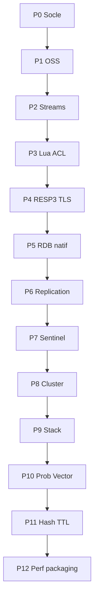

# Plan d’implémentation — parité Redis complète (Ferredis)

## Objectif et baseline

- **Cible :** Redis Open Source **8.0** (cœur 7.2, Stack, probabilistes, Vector set, hash field TTL).
- **Baseline :** inventaire dans `ferredis-core` (`command_registry`), `REDIS_COMPAT_VERSION` dans `cmd_server.rs`, RESP2, RDB `FRDB001`, pas de réplication / Sentinel / Cluster / TLS réel.
- **Règle de vérité :** comportement Redis/Memurai ; chaque écart = bug Ferredis.
- **Zéro impasse :** aucun report « nice-to-have / OS-only / stub OK en prod ». Un stub n’est accepté que le temps d’une phase non atteinte, listé dans `command_matrix`, et disparaît à la phase prévue.
- **Critère de fin de phase :** tests dédiés + smoke `redis-py`/`redis-cli` + diff `COMMAND LIST` ; **tests verts Windows et Linux** ; `INFO redis_version` avancé selon la phase.

## Contraintes Galaxy (strict)

- **Interdit** de modifier `galaxy_reborn` (settings, apps, scripts, deps).
- Intégration = env uniquement (`REDIS_URL` / broker déjà configurés). Scripts de smoke dans **ferredis** seulement.
- Tout écart vs Redis/Memurai = **bug Ferredis**.

## Principes d’ingénierie transverses (P0–P12)

### DRY

- **Une seule table de dispatch** (`command_registry`) : arity, flags, handler, catégories ; pas de second inventaire manuel.
- Factoriser parseurs d’options (`opts`), bloquants unifiés (`blocking`), codec RDB partagé (P5).
- Interdit : copier-coller de commandes quasi identiques sans paramètre générique.

### SOLID

- Un module = une famille ; `command.rs` = admission + dispatch.
- Ajouter une commande = enregistrement dans la table.
- Traits stables pour store, persistence, RESP writer ; tests sans socket.

### Performance (multithreading Rust)

- Tokio multi-thread ; CPU long → `spawn_blocking` / pool dédié.
- BGSAVE / AOF / UNLINK async / eviction en tâches de fond.
- Benches `redis-benchmark` Win+Linux (P12) ; régression = échec de phase.

### Compatibilité native Linux / Windows

- Serveur natif sur les deux OS (pas WSL/Docker obligatoire).
- Features OS-sensibles : implémentation correcte sur **chaque** OS (BGSAVE sans `fork` sous Windows, Unix socket Linux, named pipe Windows documenté/testé).
- **CI obligatoire** : `windows-latest` **et** `ubuntu-latest` pour `cargo test --workspace --exclude ferredis-gui` sur chaque PR.
- Interdit de merger si un seul OS est rouge.

### Qualité « aucune impasse »

- Pas de `todo!`, `unimplemented!`, `OK` no-op permanent après la phase propriétaire.
- Matrice `command_matrix` : commandes différées par phase ; CI vérifie qu’aucun stub P0 ne reste marqué `todo` après P0.
- Parité sémantique (erreurs, options, edge cases) avant micro-optimisations.

**Décisions figées :**

1. RDB Redis-compatible (P5) ; transition depuis `FRDB001`.
2. RESP3 avant client tracking / HELLO 3.
3. Ordre HA : réplication → Sentinel → Cluster.
4. Stack embarqué (Redis 8) ; `MODULE LIST` = modules internes — **après** HA (P9 après P8).
5. Encodings Redis réels en **P12** ; sémantique correcte avant.
6. SOLID/DRY dès **P0** (dispatch avant P1).
7. CI bi-OS gate chaque phase.
8. **Exécution strictement séquentielle** : une phase à la fois ; interdit de paralléliser des phases qui touchent `command_registry` / `value.rs` / `rdb/*` / `server.rs` / `persist.rs`.

---

## P0 — Socle de conformité

**Fichiers :** `command_registry.rs`, `command_matrix.rs`, `stats.rs`, `slowlog.rs`, `latency.rs`, `monitor.rs`, `conf.rs`, `cmd_server.rs`, `server.rs`, `command.rs`.

**Checklist :**

- [x] Matrice COMMAND + allowlist phases futures (`command_matrix`)
- [x] `COMMAND` COUNT/LIST/INFO/DOCS/GETKEYS/GETKEYSANDFLAGS (source unique registry)
- [x] Stats : keyspace hits/misses, compteurs par commande → `INFO` / `CONFIG RESETSTAT`
- [x] `SLOWLOG` GET/LEN/RESET (ring buffer)
- [x] `LATENCY` LATEST/HISTORY/RESET/DOCTOR/GRAPH/HISTOGRAM
- [x] `MONITOR` fan-out
- [x] `SHUTDOWN` NOSAVE|SAVE|NOW|FORCE|ABORT
- [x] `LOLWUT`
- [x] `FLUSHDB`/`FLUSHALL` ASYNC|SYNC
- [x] `UNLINK` async
- [x] `LASTSAVE` timestamp réel après SAVE/BGSAVE
- [x] `CONFIG GET/SET` surface élargie, `RESETSTAT`, `REWRITE`
- [x] Parsing `ferredis.conf` au démarrage
- [x] protected-mode, bind, port ; prep Unix socket (Linux) / named pipe (Windows)
- [ ] `WAIT` avec réplicas (API stable → 0 jusqu’à P6)

**Acceptation P0 :** tests unitaires socle + CI Win/Linux verts ; pas de stub permanent sur le périmètre ci-dessus.

---

## P1 — Cœur OSS manquant (hors streams groups / HA)

Bitmaps (`BITPOS`, `BITOP`, `BITFIELD*`), `LMPOP`/`BLMPOP`, `SINTERCARD`, `HRANDFIELD`, zset lex/diff/inter/union/zmpop, HLL dense/sparse, geo geohash 52-bit, `SORT`/`LCS`/`SWAPDB`, pub/sub sharded, transactions WATCH/MULTI alignées.

`DUMP`/`RESTORE`/`MIGRATE` : **livré en P5** (surface tracée ici).

**Fichiers :** `cmd_bitmap.rs`, `hll.rs`/`cmd_hll.rs`, `geohash.rs`/`cmd_geo.rs`, `cmd_sort.rs`, `cmd_pubsub.rs`, `cmd_zset.rs`, `blocking.rs`, `latency.rs`, `command_registry.rs` (handler + arité génériques).

**Checklist :**

- [x] `SETBIT`/`GETBIT`/`BITCOUNT` BYTE|BIT, `BITPOS`, `BITOP` (parallèle au-delà de 4 Mo), `BITFIELD`/`BITFIELD_RO`
- [x] `LMPOP`/`BLMPOP`, `ZMPOP`/`BZMPOP` (moteur bloquant unique)
- [x] `SINTERCARD`, `HRANDFIELD`, `SRANDMEMBER` (comptes négatifs)
- [x] Zset lex/range/setops : `ZRANGE BYLEX|BYSCORE|REV|LIMIT`, `ZRANGESTORE`, `Z*BYLEX`, `ZLEXCOUNT`, `ZDIFF*`, `ZINTER*`, `ZINTERCARD`, `ZUNION*`, `ZRANDMEMBER`
- [x] HyperLogLog Redis (sparse/dense, `HYLL`) : `PFADD`/`PFCOUNT`/`PFMERGE`/`PFDEBUG`/`PFSELFTEST`
- [x] Géo geohash 52 bits : `GEOADD NX|XX|CH`, `GEOPOS`, `GEODIST`, `GEOHASH`, `GEORADIUS*`, `GEOSEARCH*`
- [x] `SORT`/`SORT_RO` (BY/GET/`->champ`/ALPHA/LIMIT/STORE), `LCS`, `SWAPDB`
- [x] Pub/sub shardé : `SPUBLISH`/`SSUBSCRIBE`/`SUNSUBSCRIBE`, `PUBSUB SHARDCHANNELS|SHARDNUMSUB`
- [x] Transactions : validation à la mise en file (EXECABORT), commandes bloquantes non bloquantes dans EXEC
- [x] Reliquats P0 : `LATENCY GRAPH` (sparkline Redis), `LATENCY HISTOGRAM` (paliers 2^k), modèle d'échantillons Redis

**Acceptation :** tests familles + diff commandes P1 ; bi-OS vert.

---

## P2 — Streams complets

`XADD` options Redis 7+, `XREAD BLOCK`, groups (`XGROUP`, `XREADGROUP`, `XACK`, `XCLAIM`, `XAUTOCLAIM`, `XPENDING`, `XINFO`).

**Fichiers :** `cmd_stream.rs`, `value.rs` (Stream/groups/PEL), `blocking.rs`, `command_registry.rs`, `persist.rs` (FRDB tag 7 + AOF groups).

**Checklist :**

- [x] Modèle `Stream` : `BTreeMap` d’IDs, groups, PEL, consumers, `entries_added` / `max_deleted_id` / first|recorded ids, lag Redis 7
- [x] `XADD` : NOMKSTREAM, MAXLEN/MINID `~|=` + LIMIT, IDs `*` / `ms-*` / explicites, erreurs d’ordre
- [x] `XREAD` BLOCK via moteur `blocking.rs` (pas de copie), `$`, multi-clés, COUNT
- [x] `XRANGE`/`XREVRANGE` (exclusive `(`, `-`, `+`, COUNT), `XLEN`, `XDEL`, `XTRIM`, `XSETID` (ENTRIESADDED, MAXDELETEDID)
- [x] `XGROUP` CREATE (MKSTREAM, ENTRIESREAD) / CREATECONSUMER / DELCONSUMER / DESTROY / SETID / HELP
- [x] `XREADGROUP` (GROUP, COUNT, BLOCK, NOACK, `>` + historique), `XACK`, `XCLAIM`, `XAUTOCLAIM`, `XPENDING`
- [x] `XINFO` STREAM [FULL [COUNT]] / GROUPS / CONSUMERS / HELP
- [x] Persist/rejeu groups via FRDB/AOF ; notifs keyspace + wake blocked ; invalidation WATCH via mutation Entry
- [x] Registry arity/flags ; retrait allowlist `command_matrix` P2
- [x] Reliquat P1 : `PFSELFTEST` volume Redis complet (`1000` / `10_000_000`) via `block_in_place`

**Acceptation :** consumer groups + BLOCK sans stub ; bi-OS vert.

---

## P3 — Lua, Functions, ACL, admin clients

Lua `cjson`/`bit`/`cmsgpack`, `SCRIPT KILL`/`DEBUG`, `FUNCTION*`/`FCALL*`, ACL fichier, `CLIENT`/`MEMORY` réels, `EVAL_RO` refus écriture.

**Fichiers :** `script.rs`, `functions.rs`, `acl.rs`, `cmd_server.rs` (CLIENT/MEMORY), `clients.rs`, `command.rs` / `command_registry.rs`, `persist.rs` (FRDB FNS1 + AOF FUNCTION LOAD).

**Checklist :**

- [x] Lua : `cjson`, `cmsgpack`, `bit` ; `redis.log` / `redis.setresp` / status replies ; shebang `flags=no-writes`
- [x] `SCRIPT LOAD|EXISTS|FLUSH|KILL|DEBUG` ; `EVAL`/`EVALSHA` + `EVAL_RO`/`EVALSHA_RO` (refus écritures)
- [x] Functions : `FUNCTION LOAD|LIST|DELETE|FLUSH|KILL|STATS|DUMP|RESTORE|HELP` ; `FCALL`/`FCALL_RO` ; persist FRDB/AOF
- [x] ACL réel : users/passwords/hash, catégories, key/channel patterns, `SETUSER`/`GETUSER`/`LIST`/`USERS`/`WHOAMI`/`CAT`/`GENPASS`/`LOG`/`SAVE`/`LOAD`/`DRYRUN` ; checks dans dispatch ; `AUTH` branché
- [x] CLIENT : ID/INFO/LIST/KILL (TYPE/USER/LADDR/MAXAGE/SKIPME), SETNAME/GETNAME/SETINFO, UNBLOCK, PAUSE/UNPAUSE, REPLY, NO-EVICT/NO-TOUCH ; tracking basique (détails RESP3 → P4)
- [x] MEMORY : DOCTOR, MALLOC-STATS, PURGE, STATS, USAGE, HELP (métriques store)
- [x] Registry + tests `ferredis-compat` p3 ; hors allowlist `command_matrix`

**Acceptation :** ACL auth + scripts ; bi-OS vert.

---

## P4 — RESP3, TLS, I/O

Types RESP3, `HELLO 3`, push tracking, TLS rustls, Unix socket listener, prep `io-threads`.

**Fichiers :** `resp.rs`, `tracking.rs`, `tls.rs`, `unix_socket.rs`, `server.rs`, `cmd_server.rs` (CLIENT TRACKING*), `command.rs` (HELLO), `conf.rs`, `ferredis-server` CLI, smoke `integration/`.

**Checklist :**

- [x] Codec RESP3 : null / bool / double / big-number / verbatim / map / set / push / attribute ; encode selon proto connexion
- [x] `HELLO 2` et `HELLO 3` (négociation par connexion) ; réponse map en RESP3
- [x] Client tracking : `CLIENT TRACKING|CACHING|GETREDIR|TRACKINGINFO` + pushes `invalidate` sur mutations
- [x] TLS rustls (`tls-port`, cert/key, `tls-auth-clients`) ; dual plain+TLS
- [x] Unix domain socket (Linux) + named pipe (Windows) via `unixsocket`
- [x] Prep `io-threads` (CONFIG GET/SET, hint hub tracking ; perf P12)
- [x] Smoke redis-py / channels : `protocol=3` (surcharge `REDIS_PROTOCOL`)
- [x] Tests `ferredis-compat` P4

**Acceptation :** redis-cli / redis-py RESP3 ; bi-OS vert.

---

## P5 — RDB natif, DUMP/RESTORE/MIGRATE, AOF

Codec RDB Redis, migration `FRDB001`, AOF parity, `WAITAOF`, tests croisés `redis-check-rdb`.

**Fichiers :** `rdb/` (crc64, listpack, stream_codec, value/file encode-decode, frdb), `persist.rs`, `cmd_dump.rs`, `command_registry` / `command_matrix`.

**Checklist :**

- [x] Codec RDB Redis v11 (`REDIS0011`) : opcodes AUX/SELECTDB/RESIZEDB/EXPIRETIME_MS/EOF + CRC64
- [x] Types string/list/set/hash/zset_2/stream listpacks_3 ; lecture encodings listpack/ziplist/intset/quicklist
- [x] Migration one-shot `FRDB001` (+ FNS1 → FUNCTION2) au chargement
- [x] `SAVE`/`BGSAVE` écrivent le format Redis ; Functions via opcode `FUNCTION2`
- [x] `DUMP` / `RESTORE` `[REPLACE|ABSTTL|IDLETIME|FREQ]` / `RESTORE-ASKING` (sérialisation Redis + CRC)
- [x] `MIGRATE` host-port (COPY, REPLACE, AUTH/AUTH2, KEYS)
- [x] AOF : `appendfsync` ALWAYS|EVERYSEC|NO, rewrite + preamble RDB (`aof-use-rdb-preamble`), chargement preamble
- [x] `WAITAOF` (durabilité locale ; réplicas → 0 jusqu'à P6)
- [x] Streams + consumer groups persistés dans le chemin RDB natif
- [x] ACL inchangé (fichier `users.acl`, parité Redis) ; Functions dans RDB/AOF
- [x] Registry + retrait allowlist `command_matrix` P5
- [x] Tests unitaires DUMP/RESTORE + RDB load ; `ferredis-compat` p5

**Acceptation :** charger RDB Redis officiel (types supportés) ; bi-OS vert.

---

## P6 — Réplication

`REPLICAOF`, `PSYNC`, backlog, `READONLY`/`READWRITE`, `ROLE`, `WAIT`/`WAITAOF`, `FAILOVER`.

**Fichiers :** `repl.rs`, `command.rs` (`propagate`), `server.rs` (feed réplica), `command_registry` / `command_matrix`, `cmd_server` (INFO/CONFIG), `cmd_dump` (WAITAOF réplicas), `ferredis-compat/p6.rs`.

**Checklist :**

- [x] Rôle master/replica ; `REPLICAOF` / `SLAVEOF` ; `ROLE` réel ; INFO Replication (`master_replid`, offset, slaves)
- [x] `PSYNC` / `SYNC` : FULLRESYNC + RDB natif (P5) ; CONTINUE + backlog (partial resync)
- [x] `REPLCONF` listening-port / capa / ack / getack
- [x] Propagation des écritures (`CommandContext::propagate` = AOF + feed) ; réplica read-only
- [x] `READONLY` / `READWRITE` ; `WAIT` / `WAITAOF` avec acks réplica
- [x] `FAILOVER` basique (promotion réplica ; master attend rattrapage)
- [x] Registry + retrait allowlist `command_matrix` P6
- [x] Tests `ferredis-compat` p6 (handshake / WAIT / ROLE)

**Acceptation :** réplica sync smoke ; bi-OS vert.

---

## P7 — Sentinel

Mode `--sentinel`, commandes `SENTINEL *`, failover orchestré.

**Fichiers :** `sentinel.rs`, `command_registry` / `command_matrix`, `server.rs`, `ferredis-server --sentinel`, `ferredis-compat/p7.rs`.

**Checklist :**

- [x] Mode `--sentinel` + restriction des commandes
- [x] `SENTINEL MONITOR/REMOVE/SET/MASTERS/MASTER/REPLICAS/GET-MASTER-ADDR-BY-NAME/MYID/CKQUORUM/IS-MASTER-DOWN-BY-ADDR/FAILOVER/HELP`
- [x] Ping périodique, SDOWN/ODOWN (quorum), failover → `REPLICAOF NO ONE` (P6)
- [x] Tests compat p7 (monitor, failover, reject SET)

**Acceptation :** failover lab ; bi-OS vert.

---

## P8 — Cluster

Toutes sous-commandes `CLUSTER`, `-MOVED`/`-ASK`, sharded pub/sub cluster, tests multi-nœuds CI.

**Fichiers :** `cluster.rs`, `command_registry` / `command_matrix`, `--cluster-enabled`, `ferredis-compat/p8.rs`.

**Checklist :**

- [x] `CLUSTER` KEYSLOT/MYID/NODES/SLOTS/INFO/ADDSLOTS(RANGE)/DELSLOTS(RANGE)/MEET/BUMPEPOCH/FORGET/RESET/SETSLOT/COUNTKEYSINSLOT/GETKEYSINSLOT/SHARDS/…
- [x] `ASKING` + redirections `-MOVED` / `-ASK` / `CLUSTERDOWN`
- [x] CRC16 hash tags ; `--cluster-enabled`
- [x] Tests compat p8

**Acceptation :** slot migration smoke ; bi-OS vert.

---

## P9 — Stack embarqué (JSON, TimeSeries, Search)

**Fichiers :** `cmd_json.rs`, `json_path.rs`, `cmd_ts.rs`, `cmd_search.rs`, `search.rs`, `modules.rs`, `value.rs` (Json/TimeSeries), RDB types 80/81 + AUX `ferredis-ft`, `command_registry`.

**Checklist :**

- [x] `JSON.*` : ARRAPPEND/ARRINDEX/ARRINSERT/ARRLEN/ARRPOP/ARRTRIM/CLEAR/DEBUG/DEL/FORGET/GET/MERGE/MGET/MSET/NUMINCRBY/NUMMULTBY/OBJKEYS/OBJLEN/RESP/SET/STRAPPEND/STRLEN/TOGGLE/TYPE
- [x] `TS.*` : ADD/ALTER/CREATE/CREATERULE/DECRBY/DEL/DELETERULE/GET/INCRBY/INFO/MADD/MGET/MRANGE/MREVRANGE/QUERYINDEX/RANGE/REVRANGE
- [x] `FT.*` : `_LIST`/AGGREGATE/ALIAS*/ALTER/CONFIG/CREATE/CURSOR/DICT*/DROPINDEX/EXPLAIN*/INFO/PROFILE/SEARCH/SPELLCHECK/SYN*/TAGVALS
- [x] `MODULE LIST` modules internes ReJSON/timeseries/search ; LOAD/UNLOAD refusés explicitement
- [x] Persist RDB (types JSON/TS + AUX index Search) / AOF (JSON.SET, TS.CREATE/ADD)
- [x] Registry + hors allowlist `command_matrix` ; tests `ferredis-compat` p9

**Acceptation :** suite Stack ; bi-OS vert.

---

## P10 — Probabilistes + Vector set

**État de départ :** variantes `RedisValue` + structures in-memory dans `probabilistic.rs` / `vector_set.rs` ; **aucune** commande enregistrée ; RDB/AOF placeholders.

**Fichiers :** `probabilistic.rs`, `vector_set.rs`, `cmd_probabilistic.rs`, `cmd_vector.rs`, `command_registry.rs`, `command_matrix.rs`, `acl.rs`, `modules.rs`, `rdb/value_codec.rs`, `persist.rs`, `ferredis-compat/src/p10.rs`.

**Checklist :**

- [x] Algos : Bloom scaling, CF count, CMS.MERGE, TopK.INCRBY, TDIGEST MERGE/RANK/BYRANK/…, Vector attrs/VISMEMBER/options VSIM
- [x] `BF.*` : RESERVE, ADD, MADD, INSERT, EXISTS, MEXISTS, CARD, INFO, SCANDUMP, LOADCHUNK, DEBUG
- [x] `CF.*` : RESERVE, ADD, ADDNX, INSERT, INSERTNX, EXISTS, MEXISTS, DEL, COUNT, INFO, SCANDUMP, LOADCHUNK, DEBUG
- [x] `CMS.*` : INITBYDIM, INITBYPROB, INCRBY, QUERY, MERGE, INFO
- [x] `TOPK.*` : RESERVE, ADD, INCRBY, QUERY, COUNT, LIST, INFO
- [x] `TDIGEST.*` : CREATE, ADD, MERGE, RESET, MIN, MAX, QUANTILE, CDF, TRIMMED_MEAN, RANK, REVRANK, BYRANK, BYREVRANK, INFO
- [x] `V*` : VADD, VCARD, VDIM, VEMB, VGETATTR, VINFO, VISMEMBER, VLINKS, VRANDMEMBER, VREM, VSETATTR, VSIM (+ REDUCE/FP32/VALUES/CAS/quantization/EF/M/SETATTR)
- [x] ACL `@bloom` `@cuckoo` `@cms` `@topk` `@tdigest` (+ vector) ; `MODULE LIST` modules embarqués
- [x] RDB types 82–87 + AOF rewrite ; registry ; tests `p10_*_registered` ; `ferredis-compat` p10

**Décision figée :** handlers modèle `cmd_ts.rs` ; vector cosine brute + options Redis 8 exposées, zéro stub permanent.

**Acceptation :** suite structures ; bi-OS vert.

---

## P11 — Hash field TTL (Redis 7.4 / 8)

**État de départ :** Hash = `HashMap<field, value>` sans TTL champ ; TTL clé seule (`Entry.expires_at`) ; 0/12 commandes.

**Fichiers :** `value.rs`, `store_types.rs`, `store.rs`, `cmd_hash_expire.rs`, `server.rs` (purge active), RDB/AOF, `search.rs`, `command_registry` / `command_matrix`, `ferredis-compat/p11.rs`.

**Checklist :**

- [x] Modèle `HashObject` / `HashField` (`expires_at_ms`) + lazy expire centralisé (HGET/HGETALL/HLEN/HSCAN/…)
- [x] `HEXPIRE` / `HPEXPIRE` / `HEXPIREAT` / `HPEXPIREAT` (NX|XX|GT|LT + FIELDS) — moteur DRY unique
- [x] `HEXPIRETIME` / `HPEXPIRETIME` / `HTTL` / `HPTTL` / `HPERSIST`
- [x] `HGETEX` / `HSETEX` / `HGETDEL` (opts partagés `opts.rs`)
- [x] Codes Redis par champ ; purge active (`random_expire_sample`) ; RDB `TYPE_HASH_EX` + AOF `HPEXPIREAT`
- [x] Search : `HashObject::get` ignore les champs expirés
- [x] Registry + tests `p11_*_registered` ; `ferredis-compat` p11

**Décision figée :** timestamps abs ms (parité Redis) ; un seul modèle de Hash étendu.

**Acceptation :** TTL par champ ; bi-OS vert.

---

## P12 — Encodings, maxmemory, perf, packaging

**État de départ :** `maxmemory`/`io-threads` en CONFIG sans runtime ; `OBJECT ENCODING` symbolique ; `REDIS_COMPAT_VERSION = 7.2.0` ; CI tests only ; GUI sans Stack/HA.

**Fichiers :** `eviction.rs` (nouveau), `value.rs`, `cmd_key.rs`, `cmd_server.rs`, `server.rs`, `rdb/value_codec.rs`, packaging + GHA release, benches, `ferredis-gui`.

**Checklist :**

- [x] Encodings dérivés (embstr/raw/int, listpack/hashtable, intset, quicklist, skiplist) ; `OBJECT` IDLETIME/FREQ/REFCOUNT réels via `Entry`
- [x] `maxmemory` + policies Redis (`eviction.rs`) ; gate `denyoom` unique ; `CLIENT NO-EVICT` ; `evicted_keys`
- [x] INFO Memory dynamique + fragmentation/defrag champs ; pool `io_threads` effectif
- [x] Smoke perf `ferredis-compat` p12 + job release benches-smoke CI
- [x] GUI : onglets Cluster / Réplica / ACL
- [x] Packaging `packaging/package.sh` + `package.ps1` + workflow `release.yml`
- [x] `REDIS_COMPAT_VERSION` → `8.0.0` ; `DEFERRED` vide ; audit gate unique maxmemory (DRY)

**Acceptation :** packaging natif **même jeu de features** Win+Linux ; zéro stub matrice.

---

## Organisation workspace (cible)

| Zone | Rôle |
|------|------|
| `ferredis-core` | Moteur, commandes OSS, Stack, probabilistes, vector |
| `ferredis-rdb` (P5) | Codec RDB unique |
| `ferredis-compat` | Parité TCP golden Win+Linux (p1…p12) |
| `ferredis-gui` | Dashboard + Stack/HA (P12) |
| `integration/` | smokes redis-py, Galaxy via env |
| packaging / benches | Artefacts bi-OS + perf (P12) |

## Gate CI (transverse)

- Matrix `ubuntu-latest` + `windows-latest` : `cargo test --workspace --exclude ferredis-gui`.
- Phases P6+ : jobs multi-process réplication/cluster.
- Échec si stub permanent ou commande cible de phase courante manquante.

## Traçabilité audit → phase

Voir plan détaillé `.cursor/plans/` (lecture seule) ; table maîtresse alignée P0–P12 ci-dessus.

## Validation Galaxy (inchangée)

1. `ferredis-server` sur `6379`
2. `REDIS_URL=redis://127.0.0.1:6379/0` sans toucher Galaxy
3. Login admin_test / admin123 ; session, cache, Celery, WebSocket
4. Scripts `integration/` dans ferredis uniquement
